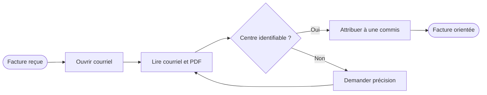
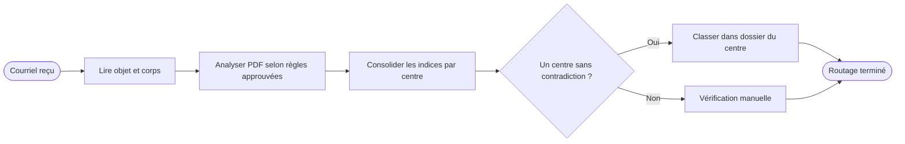
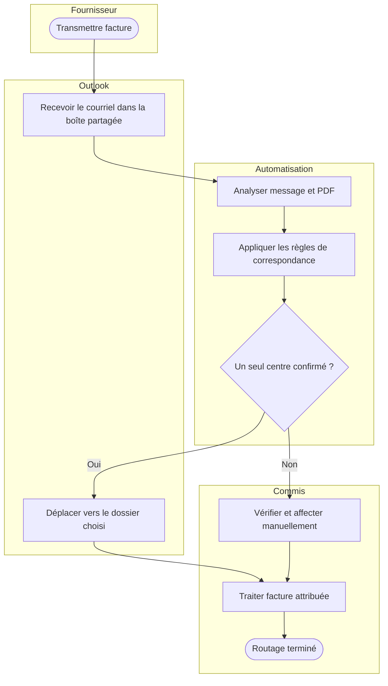

# Cartographies du processus — exemples fictifs

## AS-IS (état actuel hypothétique)

## TO-BE (état cible)

## Version à couloirs — esquisse Mermaid

> Ce dernier est une **cartographie fonctionnelle à couloirs**, pas un fichier BPMN 2.0 conforme. Pour une carte de processus normative, réaliser dans Bizagi ou Camunda deux pools (Fournisseur, Organisation), des lanes (Commis, Système) et des flux de message entre pools.
