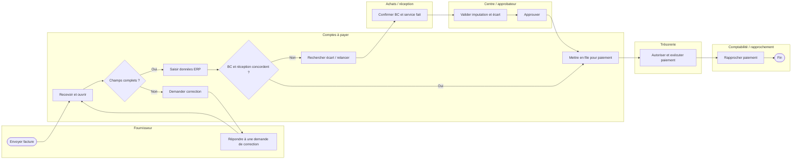

# M — MEASURE | Cartographie AS-IS, observations et plan de collecte

## 1. Processus observé (hypothétique)
Les couloirs ci-dessous sont une **cartographie fonctionnelle Mermaid**, et non un BPMN 2.0 formel. Une version normative demanderait notamment de distinguer le fournisseur externe dans un pool distinct avec des flux de message.

### Ce qui est problématique (hypothèses, pas conclusions)
- Double saisie d'informations déjà présentes dans le BC.
- Attente de réception ou d'approbation sans propriétaire explicite.
- Relance manuelle sans délai de service défini.
- Absence de motif standardisé pour le statut « en attente ».
- Données d'événements dispersées entre courriels et ERP.

## 2. Plan de collecte
| Variable | Grain | Source possible | Règle de qualité |
|---|---|---|---|
| facture_id | Facture | ERP | Unique après gestion des duplications |
| fournisseur_id / centre | Facture | ERP | Référentiels autorisés, valeurs stables |
| date_reception | Facture | Messagerie / ingestion | Première réception valable |
| date_complete | Facture | Contrôle de complétude | Nulle si incomplète |
| date_service_fait | Facture | Système réception | Conserver auteur et preuve |
| date_approbation | Facture | Workflow | Tenir compte du nombre de cycles |
| date_comptabilisation | Facture | ERP | Horodatage de l'écriture valide |
| date_paiement | Paiement | Trésorerie | Distinguer émission, confirmation, rejet |
| date_rapprochement | Paiement | Banque / ERP | Lien transaction → facture |
| motif_exception | Événement | Workflow | Liste contrôlée et horodatage |
| temps_actif_minutes | Activité | Observation / suivi | Temps humain actif, non délai calendaire |

**Grain** : conserver séparément la facture, le courriel, les lignes comptables, les approbations et les paiements. Une facture peut être partiellement payée et imputée à plusieurs centres. Ne pas faire de jointure naïve qui multiplie artificiellement le nombre de factures.

## 3. Échantillonnage recommandé
- Extraire idéalement **8 à 12 semaines** incluant clôture mensuelle et échéances.
- Stratifier par centre, type BC/sans BC, fournisseur et montants.
- Vérifier les cas complexes : crédits, duplicatas, factures reçues en retard, litiges, taxes, multi-centres.
- Réaliser 5 à 10 observations chronométrées et entrevues pour comprendre ce que les journaux ne montrent pas.
- Documenter les exclusions (ex. factures contestées) et les réintroduire dans le tableau des exceptions.

## 4. Indicateurs de référence à produire
- **Médiane / P90** réception → prêt à payer.
- **Temps actif total** de traitement.
- **Taux de reprise** et nombre moyen de cycles d'approbation.
- **% paiements à échéance**, à règles de dénominateur fixes.
- **Backlog** par état et âge.
- **Taux de rapprochement sans intervention**.

Voir les calculs et le jeu fictif dans [l'analyse des données](03-analyze-donnees-causes.md).
