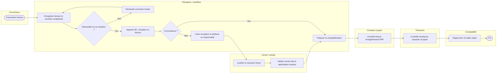

# I — IMPROVE | Processus cible, solutions et contrôles

## 1. Ne pas commencer par l'automatisation
Solutions étudiées :
- **A** : champs obligatoires à la réception + référentiel de centres + procédures standardisées.
- **B** : A + lien systématique BC/réception/facture, files d'attente visibles, assignation d'un responsable et relances ciblées.
- **C** : B + extraction de champs par OCR/IA et automatisation de cas simples **après** validation des règles.
- **D** : statu quo avec formation ponctuelle, retenu seulement comme comparaison.

### Matrice de décision fictive
Notes : 1 = défavorable, 5 = favorable. Les coûts, efforts et risques ont été évalués dans le sens « 5 = avantageux ». Pondération : bénéfice 40 %, faisabilité 25 %, risque/contrôle 25 %, adoption 10 %.

| Solution | Bénéfice | Faisabilité | Contrôle/risque | Adoption | Score /5 |
|---|---:|---:|---:|---:|---:|
| A | 3 | 5 | 5 | 4 | 4,10 |
| B | 5 | 4 | 4 | 4 | 4,40 |
| C | 5 | 2 | 3 | 3 | 3,55 |
| D | 1 | 5 | 2 | 3 | 2,45 |

*Calcul = somme(note × poids). Scores hypothétiques, non comparables sans évaluation réelle.*

**Choix pédagogique : B**, puis C seulement si le pilote montre que l'extraction de données apporte une valeur nette.

## 2. TO-BE — représentation à couloirs (Mermaid non normatif BPMN)

## 3. Règles d'affaires cibles
| ID | Condition | Action | Contrôle/exception |
|---|---|---|---|
| R01 | Facture sans numéro, date, fournisseur ou montant nécessaire | Mettre en attente documentée | Demander correction et tracer délai |
| R02 | Clé fournisseur + n° facture + critères supplémentaires suggèrent un doublon | Suspendre jusqu'à vérification | Pas de suppression automatique |
| R03 | BC, facture et preuve de réception concordent dans tolérances approuvées | Passer à la validation adaptée | Garder trace de l'appariement |
| R04 | Écart prix/quantité ou service non reçu | Exception attribuée à achats/centre | Interdire paiement avant résolution |
| R05 | Absence de BC | Appliquer circuit dérogatoire approuvé | Vérifier imputation et délégation |
| R06 | Approbateur absent | Routage vers substitut autorisé | Journal d'audit des délégations |
| R07 | Facture approuvée, comptabilisée et exigible | Proposer en lot de paiement | Séparer préparation et autorisation |
| R08 | Paiement rejeté ou non rapproché | Ouvrir exception de trésorerie | Ne pas considérer « payé » comme « rapproché » |

## 4. Architecture fonctionnelle
- **ERP / comptes fournisseurs** : référentiel, facture, écriture, échéance, paiement.
- **Workflow d'approbation** : statuts, identité, horodatage, délégations et journal d'audit.
- **Power Automate**, si permis : notifications, collecte ou routage des validations; jamais contournement des contrôles ERP.
- **OCR/AI Builder**, au besoin : aide à la saisie avec validation de la confiance et des champs critiques.
- **BI** : mesures basées sur les événements, pas sur les seuls états actuels.

## 5. Risques et mesures
- Risque de payer en double → détection des doublons + validation humaine.
- Risque de mauvaise imputation → catalogue des centres + autorisation du propriétaire.
- Risque de paiement non autorisé → droits séparés, approbation ERP, audit.
- Risque de confidentialité → minimisation, accès par rôle, rétention.
- Risque de rejet bancaire → surveillance des rejets et rapprochement.
- Risque d'échec d'intégration → file d'erreurs, rejouabilité idempotente, procédure manuelle.

**Livrables** : TO-BE approuvé, règles et responsabilités, analyse des risques, solution pilote retenue.
