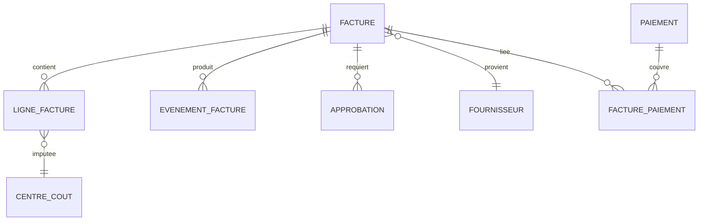

# C — CONTROL | Tableau de bord BI, contrôles et pérennisation

## 1. Tableau de bord recommandé (Power BI ou Excel)
**Page Direction** : factures reçues, payées à échéance, médiane et P90 prêt à payer, reprises, heures actives, backlog et tendance.
**Page Opérations** : volumes par centre et statut, exceptions par motif et âge, tâches en attente par responsable.
**Page Contrôle** : factures avec écart, doublons suspects, approbations manquantes, paiements rejetés, rapprochements non complétés.
**Page Diagnostic** : Pareto, durée par étape, comparaisons BC/sans BC, fournisseurs et périodes.

## 2. Dictionnaire des KPI
| KPI | Définition / calcul | Fréquence | Propriétaire | Seuil pédagogique |
|---|---|---|---|---|
| Médiane prêt à payer | Médiane(date prête − date reçue) des factures admissibles | Hebdo | Chef CP | ≤ 8 jours |
| Délai P90 | 90e percentile des mêmes durées | Hebdo | Chef CP | À fixer selon baseline |
| Reprises | Factures avec ≥1 reprise / factures admissibles | Hebdo | CP | ≤ 10 % |
| Paiement à échéance | Factures payées avant/à l'échéance / factures exigibles considérées | Mensuel | Trésorerie | ≥ 93 % |
| Exceptions âgées | Exceptions ouvertes depuis >5 jours ouvrables | Quotidien | Propriétaire étape | Examiner chaque cas |
| Doublons payés | Nombre de paiements confirmés en double | Quotidien | Contrôle financier | 0 |
| Approbations manquantes | Factures payées sans preuve requise | Quotidien | Contrôle financier | 0 |
| Temps actif | Somme des minutes humaines / factures traitées | Mensuel | Analyste BI | Réduire sans baisser qualité |

**Ne pas effacer les exceptions ouvertes du dénominateur** pour rendre les KPI artificiellement meilleurs. Documenter censures et dossiers encore ouverts.

## 3. Schéma conceptuel de données

**Grains** : une ligne `FACTURE` par facture, une ligne `EVENEMENT_FACTURE` par transition, `LIGNE_FACTURE` pour les imputations, table de lien pour paiements partiels et groupés. Les regroupements BI doivent éviter les doubles comptages.

## 4. Plan de contrôle
| Événement | Détection | Action corrective | Responsable |
|---|---|---|---|
| Exception > 5 jours ouvrables | Vue backlog quotidienne | Relance + escalade selon matrice | Propriétaire étape |
| Reprises > 10 % | Tendance hebdomadaire | Analyser motifs et centres; corriger règles | Chef CP |
| Approbation absente | Contrôle transactionnel | Bloquer avant paiement, investiguer | Contrôle financier |
| Paiement rejeté | Statut bancaire | Réconcilier, documenter et reprendre | Trésorerie |
| Hausse du temps actif | Revue mensuelle | Observer le travail réel, recalibrer | Analyste BI |
| Perte du suivi / erreurs d'intégration | Journal de flux et ERP | Reprise manuelle autorisée, incident TI | TI + CP |

## 5. Gouvernance des données
- Contrôler habilitations, secrets, comptes de service et droits de lecture.
- Ne pas publier de données réelles fournisseurs, comptes bancaires, N° fiscaux, courriels ou factures dans un dépôt public.
- Surveiller les modifications des règles de délégation, du plan de comptes et des centres.
- Conserver les dates et événements pour permettre l'audit des reprises et calculs historiques.
- Définir les durées de conservation selon les politiques et obligations en vigueur.

## 6. Revues 30 / 60 / 90 jours
- **J+30** : stabilité, incidents, charge réelle, adaptation des utilisateurs.
- **J+60** : mesure avant/après par centre et type de facture.
- **J+90** : revue financière, risques, décisions d'extension ou correction.

**Clôture** : le projet se termine seulement quand la surveillance et la propriété opérationnelle sont transférées.
