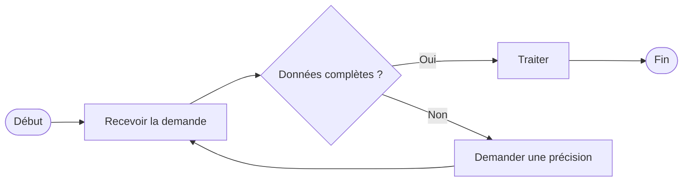

# Gabarit — Cartographie AS-IS / TO-BE (MEASURE / IMPROVE)

**Nom du processus :** [ ]
**Type :** [AS-IS / TO-BE]
**Version / date :** [ ]
**Déclencheur :** [ ]
**Résultat final :** [ ]
**Périmètre et exclusions :** [ ]
**Participants et systèmes :** [ ]

## Registre des activités
| N° | Activité | Responsable (couloir) | Entrée | Décision / règle | Sortie | Temps actif | Attente | Exception |
|---|---|---|---|---|---|---|---|---|
| 1 | [ ] | [ ] | [ ] | [ ] | [ ] | [ ] | [ ] | [ ] |

## Diagramme de flux rapide (Mermaid)

> Pour un BPMN 2.0 strict, utiliser un modeleur et distinguer pools, lanes, flux de séquence et flux de message. Mermaid sert ici d'ébauche.

## Vérifications
- [ ] Participants interrogés et diagramme validé
- [ ] Décisions Oui/Non explicites
- [ ] Exceptions et retours inclus
- [ ] Transferts / files d'attente identifiés
- [ ] Données disponibles pour chaque règle
- [ ] Version approuvée et responsable nommé

**Différences AS-IS → TO-BE :** [ ]
**Risques créés par le changement :** [ ]
